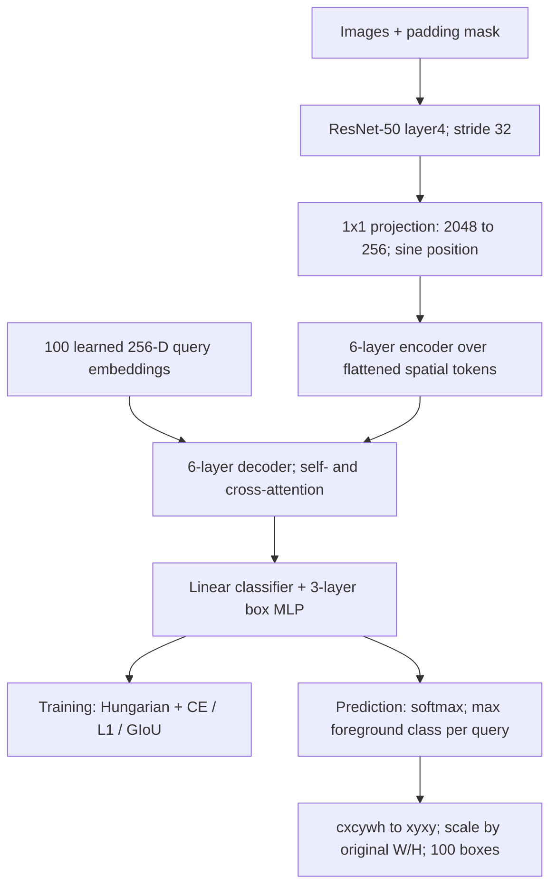

# DETR: source-level investigation

Inspected repository: `facebookresearch/detr`; immutable commit
`29901c51d7fe8712168b8d0d64351170bc0f83e0` (shallow clone of official `main`, inspected 2026-10-27).
Framework: PyTorch, torchvision ResNet, SciPy Hungarian solver. Original paper:
Carion et al., *End-to-End Object Detection with Transformers*, ECCV 2020,
https://arxiv.org/abs/2005.12872. This is original DETR, not Deformable DETR or RT-DETR.

## Source-derived pipeline



This graph is reconstructed from `models/backbone.py:58-119`,
`models/transformer.py:47-59`, and `models/detr.py:21-72,258-286`.
The shared assignment template's "multi-scale features -> neck" is not mandatory:
plain DETR's detection mode uses only `layer4` and has no FPN/PAN. A 1x1
channel projection and transformer perform the feature adaptation. `args.masks`
can request intermediate layers for segmentation, but the detection `forward`
still selects `features[-1]`. Ordinary ResNet-50 emits 2048 channels;
`input_proj` maps to 256. This code is not a multi-scale DETR implementation.

`main.py:35-56` selects ResNet-50, sine positional encoding, 6 encoder layers,
6 decoder layers, 256 hidden dimensions, 8 heads, 2048 FFN dimension and 100
queries. Do not confuse the `Transformer` constructor's generic `d_model=512`
with the actual CLI default: `build_transformer(args)` passes `args.hidden_dim`.
Padding is represented by `NestedTensor`; `BackboneBase.forward` resizes its mask
to feature resolution. `Transformer.forward` converts Bx256xHxW to HWxBx256,
replicates the learned queries across the batch, initializes zero-valued decoder
content, and supplies learned queries as positional query embeddings.

`DETR.__init__` creates a class linear layer of size `num_classes+1`, a
three-layer box MLP, and `nn.Embedding(num_queries, hidden_dim)`.
`DETR.forward` applies `sigmoid` to four box outputs and returns the final
decoder layer. The boxes are normalized **(cx, cy, w, h)**; verify the implementation
in `util/box_ops.py:9-13`, since the forward docstring accidentally swaps width
and height in its prose. For COCO the repository passes `num_classes=91` to
preserve sparse category IDs, hence its actual logit tensor is Bx100x92, including
the no-object output; this is not an 80+1 contiguous-label implementation.

## Assignment and loss are separate computations

`HungarianMatcher.forward` (`models/matcher.py:34-82`) runs under
`torch.no_grad()`. For each query-target pair its cost is

`C(q,j) = -1*p_q(c_j) + 5*L1(b_q,b_j) - 2*GIoU(b_q,b_j)`

with the default coefficients in `main.py:67-72`. It creates the pairwise matrix
and uses SciPy `linear_sum_assignment`; the matching is one-to-one and global
within each image. Its classification cost is **negative probability**, not
negative log probability. The cost decides a discrete correspondence; it is not
the differentiable training loss.

`SetCriterion.loss_labels` (`models/detr.py:108-127`) first assigns every query to
the no-object class, then overwrites the matched entries with object labels.
It computes weighted cross entropy over all queries; no-object receives weight
0.1 (`eos_coef`). `loss_boxes` (`143-162`) uses L1 and 1-GIoU on matched pairs,
normalized by average ground-truth object count over workers, clamped to at least
1 (`215-237`). The weighted objective is CE + 5 L1 + 2 GIoU; the weights are
applied in `engine.py:33-35`, not inside `loss_boxes`. Cardinality error is for
logging, has no gradients, and is absent from `weight_dict`.

Auxiliary decoder losses are enabled by default. In `SetCriterion.forward:239-253`
matching is recomputed for each intermediate decoder output; it does not reuse
the last layer's assignment. The detection losses are CE/L1/GIoU. Focal and Dice
appear in this file only for the optional segmentation masks and should not be
reported as the detector's ordinary classification objective.

## Inference: truly inspect what is absent

`PostProcess.forward` (`models/detr.py:258-286`) applies softmax, removes the
no-object column, selects the highest-scoring foreground class independently
for each query, converts boxes to xyxy and multiplies by `[W,H,W,H]`.
`engine.evaluate:107-108` supplies original image sizes, so returned detections
are in original pixel coordinates. The function itself contains **no NMS, no
confidence cutoff and no top-K truncation**: it returns one result per query
(100 under defaults). Excluding the no-object column does not mean it drops
no-object queries; they normally have low foreground scores. A visualization
client can threshold these scores, and COCO evaluation ranks detections, but
that is separate from this function.

## Required deep dive: why dense YOLO uses NMS while DETR can omit it

The important distinction is the supervision contract. YOLO11's task-aligned
one-to-many assignment can supervise several feature locations as positives
for the same object. Independent dense predictions can therefore form multiple
valid, overlapping hypotheses; its inference path explicitly decodes and calls
NMS. The companion YOLO analysis pins and traces those actual functions.
DETR instead imposes a one-to-one query-target match in
`HungarianMatcher.forward`, assigns other queries to no-object in
`SetCriterion.loss_labels`, and lets queries exchange information through
decoder self-attention (`TransformerDecoderLayer.forward_post:219-227`).
An extra duplicate has no second matching ground truth to claim and is trained
toward no-object. This is why the inspected `PostProcess` can omit NMS.

This is a training and inference design choice, not a rule that every CNN needs
NMS or every transformer is automatically NMS-free. One-to-one supervision
encourages uniqueness rather than mathematically guaranteeing no duplicate
errors at inference. The query budget caps output count; if an image has more
targets than queries, Hungarian can match only `min(Q,M)` targets. Full spatial
self-attention and a single stride-32 feature map impose costs and small-object
limitations; no AP or latency claim is measured by this static investigation.

## Reproduction and limitations

```
git clone https://github.com/facebookresearch/detr.git upstream/detr
git -C upstream/detr checkout 29901c51d7fe8712168b8d0d64351170bc0f83e0
rg -n 'class DETR|class SetCriterion|class PostProcess' upstream/detr/models/detr.py
rg -n 'linear_sum_assignment|cost_class|cost_bbox|cost_giou' upstream/detr/models/matcher.py
```

The investigation reads and traces real source; it does not execute the neural
network, load a checkpoint, train, or compute benchmark accuracy. The old
repository's broad `torch>=1.5.0` and `torchvision>=0.6.0` requirements are not a
validated runtime lockfile. Static symbol checks are useful evidence of source
inspection but do not establish runtime compatibility or model quality.

Evaluation nuance: the official engine also calls the criterion to compute validation losses, which invokes matching. Matching is absent from PostProcess and is unnecessary to produce predictions.
