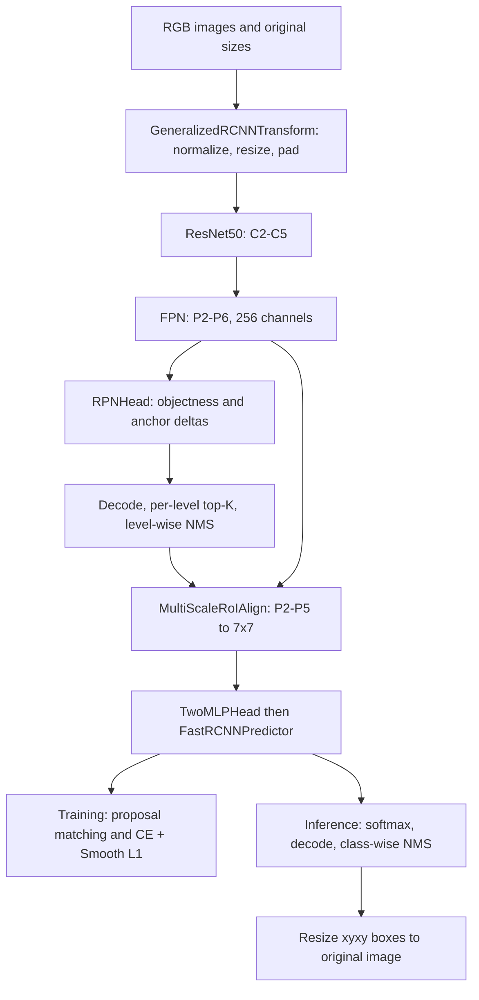
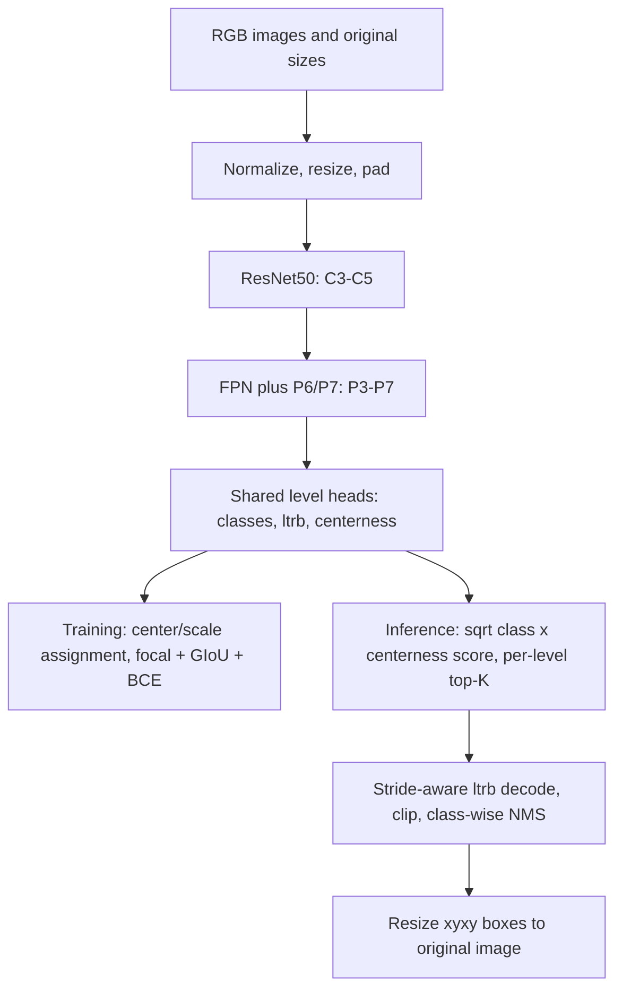

# TorchVision source investigation: Faster R-CNN and FCOS

## Scope and immutable source

- Repository: https://github.com/pytorch/vision
- Inspected release: `v0.20.1`
- Resolved commit: `3ac97aa9120137381ed1060f37237e44485ac2aa`
- Framework: PyTorch / TorchVision.
- Exact variants: `fasterrcnn_resnet50_fpn` (the original factory, **not** the v2 factory) and `fcos_resnet50_fpn`.
- This investigation reads code; it does not claim pretrained inference, dataset evaluation, training, or hardware throughput measurements.
- All line numbers below refer to the pinned commit, not the moving main branch. Evidence JSON accompanies these notes.

## Shared backbone and FPN: what the implementation actually builds

Both selected factories call `resnet50` in `torchvision/models/resnet.py`. The function creates `ResNet(Bottleneck, [3,4,6,3], ...)` (lines 736-763). `Bottleneck.forward` performs the 1x1 -> 3x3 -> 1x1 residual path plus identity addition (108-163). TorchVision explicitly puts downsampling stride in the 3x3 convolution: this is the V1.5 implementation convention, unlike the original paper's stride placement. The detector backbone returns intermediate residual stages rather than classification pooling / fully connected output.

`backbone_utils.py::_resnet_fpn_extractor` (118-150) selects ResNet layers and constructs `BackboneWithFPN` with **256 output channels** at every pyramid level. `FeaturePyramidNetwork.forward` in `torchvision/ops/feature_pyramid_network.py` (172-204) computes lateral features, nearest-neighbor upsamples the previous coarser feature, **adds** it to the lateral feature, and applies the output block. This is top-down FPN addition, not YOLO's concatenation-based PAN path.

Faster R-CNN returns residual layers `[1,2,3,4]` (C2-C5), obtaining P2-P5 plus the pooled P6 from `LastLevelMaxPool` (207-221). Its RPN receives all five maps; `MultiScaleRoIAlign` receives only keys `0,1,2,3`, corresponding to P2-P5 (`faster_rcnn.py` 250-257).

FCOS explicitly chooses residual layers `[2,3,4]` (C3-C5) and `LastLevelP6P7(256,256)` (`fcos.py` 766-770), obtaining P3-P7. Because input and output channels match, `LastLevelP6P7` starts from P5, adds a stride-2 convolution for P6 and a ReLU then stride-2 convolution for P7 (`feature_pyramid_network.py` 224-250). The two detectors therefore share a backbone family but do **not** use identical pyramid levels.

## Faster R-CNN: two-stage anchor-based detector

### Source-derived graph

`GeneralizedRCNN.forward` (`generalized_rcnn.py` 46-110) is the controlling pipeline: save original sizes -> transform -> backbone -> RPN -> RoI heads -> transform postprocess. The training branch returns merged RPN and detector losses; the evaluation branch returns detection dictionaries.

### Anchors, tensor outputs, and two assignment steps

`_default_anchorgen` (`faster_rcnn.py` 37-40) uses sizes `32,64,128,256,512`, one size per pyramid level, and aspect ratios `0.5,1,2`: **three anchors per spatial location**, not nine at every FPN location. `RPNHead.forward` (`rpn.py` 71-78) returns per-level objectness logits and 4A coordinate deltas. `concat_box_prediction_layers` (88-110) flattens level outputs so each anchor has one logit and four deltas.

`RegionProposalNetwork.assign_targets_to_anchors` (`rpn.py` 193-229) computes GT-anchor IoU and calls `Matcher`. Defaults in `FasterRCNN.__init__` (`faster_rcnn.py` 179-198) are foreground IoU >= 0.7, background < 0.3, with in-between anchors ignored; `allow_low_quality_matches=True` additionally restores anchors with the highest available IoU for a GT, including ties (`_utils.py` 358-417). RPN sampling is 256 anchors/image with positive fraction 0.5. Because many anchors can match the same object, these labels are many-to-one.

The RoI stage performs a second IoU assignment on proposals. `RoIHeads.select_training_samples` (`roi_heads.py` 630-666) appends GT boxes to proposals, matches them, samples, and box-encodes matched targets. RoI foreground/background thresholds are both 0.5, the batch is 512/image with positive fraction 0.25, and low-quality matching is disabled (`roi_heads.py` 524-532). Appending GT proposals supplies useful positives even when the current RPN is weak.

`MultiScaleRoIAlign(...output_size=7,sampling_ratio=2)` produces fixed spatial features. `TwoMLPHead` flattens each 256x7x7 crop and applies two 1024-dimensional linear layers with ReLU (`faster_rcnn.py` 286-306). `FastRCNNPredictor` (347-373) outputs C class logits **including background**, and 4C class-specific box deltas. Here C is the implementation's class count; the factory defaults to 91 COCO index slots including unused slots, rather than saying there are 90 semantic object categories.

### Losses and box encoding

RPN `compute_loss` (`rpn.py` 299-334) uses binary cross-entropy with logits on sampled positive and negative anchors. Smooth L1 (`beta=1/9`) is applied only to positive-anchor deltas, summed and normalized by the sampled anchor count.

`roi_heads.py::fastrcnn_loss` (12-49) applies softmax cross-entropy on sampled RoIs. Positive RoIs select the regression slice for their GT class; Smooth L1 (`beta=1/9`) is summed on those slices and normalized by all sampled RoIs. Neither stage uses focal loss, GIoU, CIoU or DFL in this selected default implementation.

`_utils.py::encode_boxes` (75-119) represents boxes by weighted normalized center shifts and log-scale width/height ratios. RPN weights are `(1,1,1,1)` (`rpn.py` 164); RoI weights are `(10,10,5,5)` (`roi_heads.py` 530-532). `BoxCoder.decode_single` (`_utils.py` 183-224) reverses this transform and clamps width/height log deltas before exponentiation.

### Inference and output coordinates

`RegionProposalNetwork.forward` (`rpn.py` 359-375) decodes **detached** RPN deltas; the RoI loss therefore does not backpropagate through proposal coordinates. `filter_proposals` (242-297) selects top proposals independently per pyramid level, clips to the resized image, removes small/low-score boxes, and performs NMS using pyramid level as the grouping key. Test defaults: 1000 pre-NMS candidates/level, up to 1000 post-NMS proposals/image, NMS IoU 0.7, score threshold 0.0.

`RoIHeads.postprocess_detections` (`roi_heads.py` 668-725) decodes class-specific boxes, softmaxes logits, removes the background column, flattens proposal-class pairs, applies score > 0.05 and minimum-size filtering, then **class-wise** NMS at IoU 0.5, retaining at most 100 detections/image. RPN NMS groups by level; final NMS groups by class: they are separate operations with distinct purposes.

`GeneralizedRCNNTransform.postprocess` (`transform.py` 257-277) calls `resize_boxes` (306-320). x coordinates are multiplied by original_width / resized_width; y coordinates by original_height / resized_height. This restores coordinates after the detector's aspect-preserving resize, independently of padded batch dimensions.

## FCOS: one-stage point-based dense detector

### Source-derived graph

### Why the class named AnchorGenerator does not make FCOS anchor-based

`FCOS.__init__` (`fcos.py` 400-414) constructs `AnchorGenerator` with square sizes equal to feature strides `8,16,32,64,128` and a single ratio `1.0`. It requires exactly one reference per location. These square references store the grid center and stride for shared utilities; prediction is center-to-edge distance and assignment does not compare anchor overlap. Therefore FCOS remains semantically **anchor-free**. The meaningful distinction is the prediction/assignment rule, not a utility variable's name.

### Heads and shape trace

`FCOSHead` (31-134) has a separate classification tower and regression tower, each with four 3x3 convolution + GroupNorm(32 groups) + ReLU blocks by default. Each tower's weights are reused across feature levels. Classification produces C independent sigmoid logits/location. The regression tower predicts 4 nonnegative ltrb values with **ReLU**, plus one centerness logit (`FCOSRegressionHead.forward`, 245-267). A location's distance predictions are normalized to stride, not log-scale anchor deltas.

`FCOSClassificationHead.forward` (183-198) reshapes `(N,A*C,H,W)` to `(N,H*W*A,C)` then concatenates levels. Here A=1. Regression outputs similarly become `(N,sum(H_l*W_l),4)` and centerness `(N,sum(H_l*W_l),1)`. Evaluation splits the concatenated arrays back into individual pyramid levels before per-level filtering (`FCOS.forward`, 637-645). No proposal pooling or second-stage head exists.

### Target assignment: geometry plus scale

`FCOS.compute_loss` (`fcos.py` 440-487) assigns a location only when all of these hold:

1. Its L-infinity distance from the GT center is < `1.5 * stride` (center sampling).
2. All four point-to-edge distances are positive (strictly inside the GT box).
3. The maximum ltrb distance lies strictly between `4*stride` and `8*stride`; the first level's lower bound is 0 and final level's upper bound is infinity.
4. If several GT boxes qualify, select the one of minimum area. Unmatched locations receive -1.

For strides 8,16,32,64,128 the default ranges are `(0,64)`, `(64,128)`, `(128,256)`, `(256,512)`, `(512,infinity)` for the maximum point-to-edge distance; these are not directly object-width bins. Many locations can still be positive for one object. This explains why changing from anchor IoU matching to center sampling does not alone remove duplicate predictions or NMS.

### Losses: implementation versus paper-level shorthand

`FCOSHead.compute_loss` (`fcos.py` 52-125) creates one-hot class targets, using all-zero vectors for background. Classification uses sigmoid focal loss over all location-class logits, with alpha=0.25 and gamma=2 inherited from `torchvision/ops/focal_loss.py::sigmoid_focal_loss` (7-58). Its equation is `-alpha_t*(1-p_t)^gamma*log(p_t)`: easy negatives are downweighted rather than subsampled as in Faster R-CNN.

Predicted ltrb values are decoded to xyxy boxes before **GIoU loss** over positive locations. `BoxLinearCoder.encode/decode` (`_utils.py` 227-311) divides targets by reference width/height when encoding, multiplies predicted distances by those sizes when decoding, and subtracts/adds from the reference center. GIoU extends IoU with a penalty for the uncovered part of the smallest enclosing box, giving a useful term even for disjoint boxes; it is not CIoU's center/aspect-ratio penalty.

Centerness target is `sqrt(min(l,r)/max(l,r) * min(t,b)/max(t,b))`; BCE-with-logits trains it on positive locations only. Classification, GIoU and centerness sums are each normalized by `max(1,num_foreground)`. This selected implementation uses no DFL. The original FCOS research and its later stronger variant explain the concepts, while the actual TorchVision details here include center sampling, stride normalization, GroupNorm, ReLU distance regression and GIoU.

### Inference and default thresholds

`FCOS.postprocess_detections` (`fcos.py` 489-556) computes `sqrt(sigmoid(class_logit)*sigmoid(centerness_logit))` for each location-class pair. It applies **score > 0.2**, then retains at most **1000 candidates per level**, decodes ltrb boxes using grid centers and strides, clips boxes, concatenates levels and performs class-wise NMS at IoU **0.6**, keeping at most **100 detections/image**. Thus its score is not a standalone class probability and should not be directly equated with Faster R-CNN softmax confidence. Original coordinates are restored by the same transform as Faster R-CNN.

## Comparison and interpretation

| Property | Faster R-CNN selected implementation | FCOS selected implementation |
|---|---|---|
| Entry class | `FasterRCNN(GeneralizedRCNN)` | `FCOS(nn.Module)` |
| Backbone | ResNet50 V1.5 | ResNet50 V1.5 |
| Neck | 256-channel FPN P2-P6; RoI pool uses P2-P5 | 256-channel FPN P3-P7 |
| Representation | Multiple aspect/scale anchors; center/log-size deltas; RoI class-specific deltas | One point/stride reference; normalized ltrb distances |
| Assignment | RPN IoU thresholds + low-quality matches; second proposal-IoU stage | Center sampling + inside-box + scale range + smallest eligible GT |
| Classification | RPN BCE; RoI softmax CE | Independent sigmoid focal loss |
| Box loss | Smooth L1 in both stages | GIoU on decoded boxes |
| Other loss | RPN objectness | Centerness BCE |
| Queries | None | None |
| Postprocessing | RPN level-wise NMS and final class-wise NMS | Final class-wise NMS |
| Primary source | `faster_rcnn.py::FasterRCNN`, `generalized_rcnn.py::GeneralizedRCNN.forward` | `fcos.py::FCOS`, `FCOSHead` |

**Technical implication:** anchor-free describes how objects are parameterized and assigned, whereas NMS-free describes how duplicate detections are controlled. FCOS removes anchor shape selection and proposal refinement yet retains many-to-one supervision and NMS. A one-to-one set-prediction detector changes this supervision relationship in addition to its architecture.

## Research references to pair with source evidence

1. Ren et al., *Faster R-CNN: Towards Real-Time Object Detection with Region Proposal Networks*, NeurIPS 2015. https://arxiv.org/abs/1506.01497
2. Tian et al., *FCOS: Fully Convolutional One-Stage Object Detection*, ICCV 2019. https://arxiv.org/abs/1904.01355
3. Tian et al., *FCOS: A Simple and Strong Anchor-Free Object Detector*, TPAMI 2022 (preprint 2020). https://arxiv.org/abs/2006.09214
4. Lin et al., *Feature Pyramid Networks for Object Detection*, CVPR 2017. https://arxiv.org/abs/1612.03144
5. Lin et al., *Focal Loss for Dense Object Detection*, ICCV 2017. https://arxiv.org/abs/1708.02002
6. Rezatofighi et al., *Generalized Intersection over Union: A Metric and a Loss for Bounding Box Regression*, CVPR 2019. https://arxiv.org/abs/1902.09630
7. TorchVision pinned official source repository. https://github.com/pytorch/vision/tree/3ac97aa9120137381ed1060f37237e44485ac2aa
