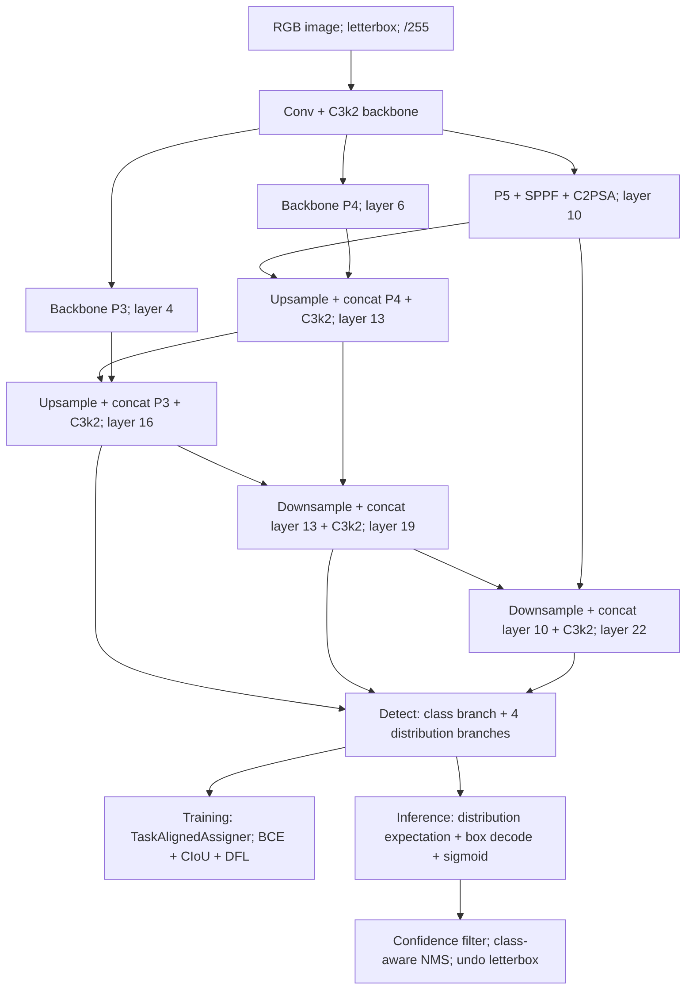

# YOLO11: source-level analysis at the initial v8.3.0 release

## Provenance and scope

- Repository: https://github.com/ultralytics/ultralytics
- Release: `v8.3.0`; resolved commit: `6e43d1e1e5db72afbf686dee6745669bcb124b0a`.
- Framework: PyTorch; source inspected locally with `nl -ba`, `rg`, and direct file reads.
- Configuration: `ultralytics/cfg/models/11/yolo11.yaml`, scale `n`, `nc=80`.
- Main class: `ultralytics/nn/tasks.py::DetectionModel`; `parse_model` constructs the graph from YAML.
- Paper attribution: cite the original YOLO paper only as family history; use the official YOLO11 release/source and documentation for this specific implementation. The assignment's original-research-paper count can be met with Faster R-CNN, FCOS, DETR, FPN, TOOD, and Generalized Focal Loss. Do not invent a canonical YOLO11 paper or attribute all implementation details to the 2016 YOLO architecture.
- This is static code analysis, not a pretrained inference experiment. No mAP, latency, GPU-memory, or measured activation-shape claim is made here.

## Model graph and backbone / neck / head boundary

`yolo11.yaml` lines 15-27 specifies strided Conv, C3k2, SPPF, and C2PSA as the backbone. C3k2 (`nn/modules/block.py:723-731`) subclasses C2f and switches its inner modules between Bottleneck and C3k. SPPF (`block.py:169-188`) applies the same stride-1 max pooling three times sequentially and concatenates four tensors, expanding receptive field without changing feature-map resolution. C2PSA (`block.py:1027-1041`) projects and splits channels, sends one split through PSABlock attention/feed-forward modules, concatenates with the bypass split, and projects again. Attention operates on a channel subset, not on the whole feature tensor directly.

The YAML calls lines 30-47 `head`, but this includes both feature fusion and the prediction module. For architecture comparison, lines 31-45 form the neck: nearest-neighbor upsampling and lateral concatenation perform top-down fusion, followed by strided Conv and concatenation for bottom-up aggregation. This is FPN/PAN-style connectivity, not an instantiation of TorchVision's `FeaturePyramidNetwork` or an exact claim that the full original PANet is implemented. `Detect` alone at layer 23 is the prediction head, taking layers 16, 19, and 22 (P3/P4/P5).

`parse_model` (`nn/tasks.py:933-946,957-1029`) applies `n` depth=0.50 and width=0.25, rounds output channels to a multiple of eight, and inserts repeated-block counts into C3k2 and C2PSA constructors. Concat channels are summed and the Detect input-channel list is injected at lines 1042-1045. Therefore the unscaled YAML numbers must not be quoted as actual YOLO11n channels.

### Original code-derived diagram

## Head representation and static tensor derivation

`Detect.__init__` (`nn/modules/head.py:32-52`) sets `reg_max=16`, `no=nc+4*reg_max`, and separate per-scale box (`cv2`) and class (`cv3`) branches. The class branch uses depthwise convolutions and pointwise convolutions; the box branch uses regular Conv blocks. There is no separate objectness logit in this head.

For a square input tensor `[B,3,640,640]` and scale `n`, the head inputs derived from YAML plus parser channel scaling are:

| Head source | Stride | Feature shape | Points |
|---|---:|---|---:|
| layer 16 | 8 | `[B,64,80,80]` | 6,400 |
| layer 19 | 16 | `[B,128,40,40]` | 1,600 |
| layer 22 | 32 | `[B,256,20,20]` | 400 |

Each raw output is `[B,144,H,W]`: 64 distribution logits plus 80 class logits. `Detect._inference` flattens and concatenates them as `[B,144,8400]`, splits box/class channels, reduces each 16-bin side distribution to its expectation, and emits `[B,84,8400]`: four decoded xywh coordinates and 80 sigmoid class probabilities. `DFL.forward` (`block.py:62-73`) uses a fixed nontrainable integral projection with weights 0..15. These shapes are analytical deductions from inspected code; they are not runtime measurements. Ordinary rectangular letterboxing can produce different feature-map sizes.

## Why this model is anchor-free despite names such as anchors

`make_anchors` (`utils/tal.py:303-315`) creates one coordinate per spatial position with offset 0.5 and an associated stride. It does not enumerate preset width/height/aspect-ratio boxes. `dist2bbox` (lines 318-327) interprets four distances relative to these points. Thus this detector is anchor-free in the anchor-box sense even though internal names use `anchor_points` and `anchors`. This is the same distinction needed when comparing FCOS to anchor-based Faster R-CNN.

## Training and target assignment

`DetectionModel.init_criterion` (`nn/tasks.py:386-388`) chooses `v8DetectionLoss` for this non-end-to-end model. The criterion constructs `TaskAlignedAssigner(topk=10, alpha=0.5, beta=6.0)` (`utils/loss.py:160-178`), overriding the assigner class constructor's otherwise different defaults. Follow the call site rather than assuming constructor defaults are the actual model setting.

`v8DetectionLoss.__call__` concatenates raw levels, decodes predicted boxes, converts normalized xywh target boxes to pixel xyxy, and passes detached sigmoid scores, detached predicted boxes, point coordinates, and ground truth to the assigner (`loss.py:207-242`). Assignment is prediction-dependent and computed without a differentiable path through the assignment step.

`TaskAlignedAssigner.get_pos_mask` (`tal.py:90-100`) requires points inside the ground-truth box and selects top-k alignment candidates per ground-truth object. `get_box_metrics` (lines 102-125) gathers each ground-truth class's predicted score and forms:

`t = s^0.5 * u^6`, where `u = max(CIoU(predicted box, GT box), 0)` in this pinned implementation.

The common conceptual description uses IoU; the inspected code specifically requests `CIoU=True` and clamps negative values to zero. Competing assignments for the same point are resolved by highest overlap (`select_highest_overlaps`, lines 235-265). Forward then normalizes the alignment metrics with the best positive overlap to produce soft quality-weighted class targets (lines 72-88). This is one-to-many assignment: a ground-truth box can supervise multiple grid points. That multiplicity is central to why inference uses NMS.

## Losses: do not confuse DFL with the classification loss

`v8DetectionLoss` initializes `BCEWithLogitsLoss(reduction='none')` and applies it to the quality-weighted target scores (`loss.py:166,244-248`). The commented varifocal line is not executed. The presence of a FocalLoss class elsewhere in the file does not mean YOLO11 uses it here.

`BboxLoss.forward` (`loss.py:99-109`) uses quality-weighted `1-CIoU` on foreground decoded boxes and Distribution Focal Loss on four side distributions. For a continuous side target y between integer bins l=floor(y) and r=l+1, `DFLoss.__call__` (lines 73-88) is the weighted two-bin cross entropy:

`L_DFL = (r-y) CE(z,l) + (y-l) CE(z,r)`.

DFL is the distributional box-regression component introduced in Generalized Focal Loss, not the binary classification focal modulation used by FCOS. The source averages over four sides, weights foreground losses by target-score sum, and divides by total target-score mass. It applies default gains box=7.5, cls=0.5, dfl=1.5 from `cfg/default.yaml:97-99`. CIoU contributes overlap plus center-distance and aspect-ratio terms; it is not equivalent to plain IoU loss or GIoU.

## Inference, filtering, and restoration of original coordinates

`BasePredictor.preprocess` and `pre_transform` (`engine/predictor.py:122-156`) letterbox images, reorder BGR to RGB, convert BHWC to BCHW, cast to float/half, and divide ordinary uint8 image inputs by 255. `Detect._inference` (`head.py:94-120`) creates grid points, applies distribution integration, decodes distances, multiplies by stride to obtain resized-image coordinates, and applies sigmoid to class logits.

`DetectionPredictor.postprocess` (`models/yolo/detect/predict.py:23-40`) calls `ops.non_max_suppression` with configured confidence, IoU, class, and maximum-detection settings. The helper converts xywh to xyxy, confidence-filters by maximum class probability, retains a best class by default, sorts/truncates if exceeding `max_nms=30000`, offsets boxes by class unless class-agnostic behavior is requested, calls `torchvision.ops.nms`, and keeps up to `max_det` (`utils/ops.py:226-293`). This global pre-NMS candidate truncation is not the per-GT top-k target-assignment step.

`scale_boxes` (`ops.py:106-123`) subtracts horizontal and vertical letterbox padding, divides by resize gain, and clips to original image shape. Output coordinates are therefore in the original image's pixel frame.

Important branch distinction: `Detect` contains `forward_end2end`, and `non_max_suppression` can short-circuit six-column end-to-end results. However `Detect.end2end=False` (`head.py:26`), and the YOLO11 YAML uses standard `Detect`, not `v10Detect`. Consequently these branches are not evidence that standard YOLO11 is NMS-free. The selected pinned YOLO11 path uses NMS.

## Implications for the YOLO-to-DETR deep dive

The decisive difference is supervision cardinality, not merely convolution versus transformer. YOLO11's one-to-many positive assignment allows several locations to learn the same object; NMS suppresses competing overlapping predictions. DETR's Hungarian matching selects at most one prediction per ground-truth object and trains unmatched queries as no-object, discouraging duplicates during learning. Removing the NMS call alone would not turn YOLO11 into DETR or provide the one-to-one training objective. Conversely, NMS-free inference is a learned property encouraged by the assignment/loss design, not a guarantee that duplicates can never occur.
